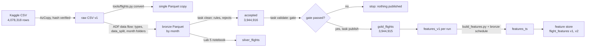

# Catalog and lineage: US flight arrival delays (2022)

This document covers requirement II.3: where the data is registered, what each dataset contains, its keys and assumptions, and how every output traces back to the raw file.
Column-level detail is in [COLUMNS.md](COLUMNS.md). Feature definitions are in [FEATURES.md](FEATURES.md). Counts below come from the saved run files in `evidence/`.

## 1. Catalog entry (Unity Catalog)

| Item | Value |
|---|---|
| Workspace catalog | `dsai3202_databricks` |
| Schema | `s_60303551` |
| Published table | `dsai3202_databricks.s_60303551.gold_flights`: Delta, external, partitioned by `Month`, 3,944,915 rows, 62 columns |
| Cleaned table | `dsai3202_databricks.s_60303551.silver_flights`: Delta, external, partitioned by `Month`, the accepted rows of the Lab-5 run |
| Storage | ADLS Gen2 account created in Lab 3 (the account also holds course-lab data under other folders; **everything in this project lives under `flights/`** and no lab dataset is used) |
| Feature store | Azure ML managed feature store: entity `Flight` v1, feature set `flight_features` v1 and v2 (definitions only, rows stay in the lake) |

## 2. Datasets and where they live

All paths are inside the storage account, under `flights/combined_flights_2022/v1/`.

| Layer | Container / path | Format | Rows | Written by |
|---|---|---|---|---|
| Source file | Kaggle, `Combined_Flights_2022.csv` | CSV, 61 columns | 4,078,318 | Kaggle (see `evidence/source-manifest.json` for version and hash) |
| Raw | `raw/…/v1/Combined_Flights_2022.csv` and `_manifest.json` | CSV | 4,078,318 | AzCopy, `--overwrite=false` |
| Single-file copy | `processed/…/v1/Combined_Flights_2022.parquet` | Parquet | 4,078,318 | `tools/flights.py convert` |
| Bronze | `processed/…/v1/bronze/month=01 … month=07/` | Parquet, 62 columns | 4,078,318 | ADF pipeline `pl_transform_flights`, data flow `df_flights_bronze` |
| Silver | `processed/…/v1/silver_flights/` and `silver_flights_rejects/run_id=…/` | Delta; Parquet | accepted; rejects | Databricks notebook `02_silver_flights.py` (Lab 5) |
| Job outputs per run | `curated/…/v1/runs/<run_id>/accepted`, `rejects`, `quarantine`, `features_v1` | Parquet | accepted 3,944,916; features 3,944,915 | Databricks job `dsai3202-phase1-flights` (Lab 6) |
| Gold | `curated/…/v1/gold_flights/` and table `gold_flights` | Delta, partitioned by `Month` | 3,944,915 | job task `publish` |
| Feature table | `curated/…/v1/features_ts/features_ts.parquet` | Parquet, 24 columns | 3,944,915 | `tools/build_features.py` |
| Quality records | `curated/…/v1/quality/lab6_runs/<run_id>/clean.json`, `gate.json`, `success.json`; `quality/drop_report.json` (Lab 5) | JSON | n/a | notebooks |
| Test input | `processed/…/v1/bronze_test/` and `curated/…/v1/quality/test_inputs/bronze_test_manifest.json` | Parquet; JSON | 81,473 | `05_make_test_input.py` |

## 3. Lineage: raw data to outputs

| Step | Input to output | Rows in to rows out | Check that proves it |
|---|---|---|---|
| Upload | Kaggle CSV to `raw/` | 4,078,318 to 4,078,318 | source, raw and manifest SHA-256 identical (`evidence/verify-1.txt`); repeat upload skipped with receipts unchanged (`evidence/receipts-*.tsv`) |
| Convert | raw CSV to single Parquet | 4,078,318 to 4,078,318 | `evidence/convert.txt`, `evidence/publish-check.txt` |
| Bronze | raw CSV to bronze by month | 4,078,318 to 4,078,318 | `tools/check_bronze.py` compares every month and the null count with the raw CSV |
| Clean | bronze to accepted | 4,078,318 to 3,944,916, with 133,402 excluded as cancelled or diverted, 0 invalid, 0 duplicates | `clean.json` balance: input = accepted + excluded + invalid + duplicate copies |
| Validate | accepted to verdict | 3,944,916 checked | `gate.json`; a test input with a planted defect was blocked |
| Publish | accepted to gold | 3,944,916 to 3,944,915 (1 row quarantined) | `success.json`: input = excluded + invalid + duplicates + quarantined + gold |
| Features | gold features to feature table | 3,944,915 to 3,944,915 | `evidence/lab7/features_ts_manifest.json` and the point-in-time audit in `evidence/lab7/build.txt` |

Unity Catalog shows table-level lineage only for reads and writes it can see. Most steps here read and write by path, so this document is the complete record; the catalog's Lineage tab is shown in `evidence/` as a screenshot where it is populated.

## 4. Keys

| Key | Columns | Notes |
|---|---|---|
| Row key (cleaning) | `FlightDate`, `Operating_Airline`, `Flight_Number_Operating_Airline`, `Origin`, `Dest`, `CRSDepTime` | One row per key after cleaning; 0 duplicate copies were found in this data |
| Feature row id | `flight_key` = date, carrier, flight number, origin, destination, scheduled departure hour | Unique in `features_ts` (checked on every build) |
| Partition | `Month` | 7 partitions in silver and gold |
| Target | `ArrDel15` (`label` in the feature table) | 1 if the flight arrived 15 or more minutes late |

## 5. Assumptions and rules

* The data covers January to July 2022 only, has no weather, and has no time zones: clock times are local and treated as one clock.
* Cancelled and diverted flights have no arrival outcome and are removed (133,402 rows, 3.27%). The model describes completed flights only.
* `ArrDel15` must agree with `ArrDelayMinutes` (1 only if the delay is 15 minutes or more). The cleaning rules, in order: missing key, cancelled, diverted, bad label, date outside 2022-01-01 to 2022-07-31, month or year not matching the date, invalid scheduled time (HHMM, 0 to 2400, minutes under 60), invalid airport code or origin equal to destination, distance missing or not positive, label inconsistent with delay minutes, duplicate key.
* One row is quarantined for having no usable scheduled elapsed time, because that is a model input.
* `data_split` is derived from `Month`: train January to April, validation May, test June, deploy July.
* Rows are never edited. Rejected, excluded and quarantined rows are saved with a reason, so nothing disappears without a record.
* Columns recorded after departure or arrival are kept in silver and gold for analysis but are never model inputs (roles in [COLUMNS.md](COLUMNS.md), reasons in [FEATURES.md](FEATURES.md)).

## 6. Versions and reproducibility

| What | Identity |
|---|---|
| Source CSV | SHA-256 `b4cde15b526c365f81a08446a3c53bf83682b2bcf95e1d33d20368a9807824a3`, 1,415,293,445 bytes |
| Feature table | SHA-256 `10f304d896e5140bbe9b15ac24e955ee62e7854344c65c8dd39b463c4caae217`, 100,352,685 bytes |
| Gold table | Delta versions 0 and 1, the two successful job runs; their content was compared row by row and is identical |
| Job runs | run IDs and verdicts in `evidence/lab6/<run_id>/` (two successful runs, one blocked run) |
| Code | `tools/`, `databricks/`, `adf/`, `spec/` in this repository; exact commands are in the README |

## 7. Limits of this record

* Lineage is documented here and in saved files, not drawn automatically for every step.
* Delta table versions 0 and 1 are different writes of the same content, not different data.
* Time zones, weather and the full year are not available in this source.

## 8. Missing values

All empty arrival, delay and time values belong to cancelled or diverted flights, which are excluded (133,402 rows). Among the 3,944,916 accepted rows, only `DivAirportLandings` has empty values (2 rows); it is recorded after departure and is not a model input. Counts per column are in [COLUMNS.md](COLUMNS.md).
